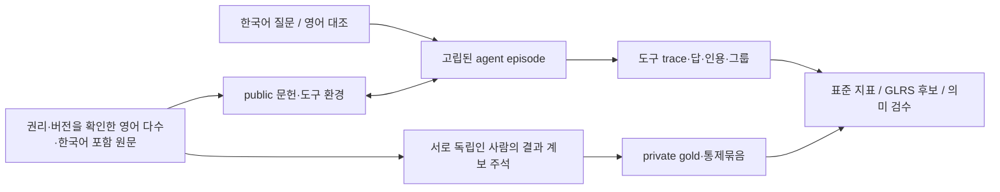

# 연구 설계: 한국어 학술 agent의 실험·결과 근거 계보

가제: **LinkPaper-KoEvidence: Evaluating Result-Provenance Reasoning in Korean Scholarly Agents**. 이 문서는 연구 가설과 구현 계획이다. 새로운 성능 결과나 세계 최초를 선언하지 않는다.

## 1. 주력 연구 질문

**영어 논문을 더 많이 포함하고 한국어 논문도 포함한 학술 코퍼스에서, 한국어로 질문받은 에이전트는 같은 실험 결과의 재보고와 새로 보고된 실험·결과 단위를 구별하는가? 문서 수·길이·주제 지지·도구 예산을 맞춘 조건에서, 재인용에는 판단을 보존하고 조건에 맞는 새 결과에는 반응하는가?**

LinkPaper의 논문·본문·CITES 구조를 사용하되, 논문 수·인용 수·저자 수를 실험 수로 대체하지 않는다. 연구 대상은 제한된 코퍼스에서의 **결과 출처 비중복성**이다. 통계적 독립성이나 과학적 진실 전체를 추정한다는 주장이 아니다.

이를 통해 검증할 가설은 다음과 같다. 방향과 크기는 측정 전 미정이다.

- H1: 최종 정답·개별 인용 정확도가 높은 시스템도 동일 결과의 재인용을 별도 실증 근거로 집계할 수 있다.
- H2: 문장 중복 제거·DOI 통합만으로는 표현이 다른 재인용과 표현이 유사한 별도 실험을 함께 처리하지 못할 수 있다.
- H3: 일반 CITES 그래프 접근의 이득과 결과 계보 추론의 이득은 다를 수 있다. GraphRAG가 항상 이긴다고 전제하지 않는다.
- H4: 같은 원문 집합에서 한국어와 영어 질문의 차이는 원문 발견·조건 해석·계보 판정 중 서로 다른 단계에서 생길 수 있다. 한국어가 반드시 낮다는 결론도 사전에 정하지 않는다. 영어 원문/한국어 원문/혼합 bundle의 차이는 별도 층화 분석이며 내용·분야가 다르면 언어의 인과 효과로 해석하지 않는다.

## 2. 기존 연구로 이미 알려진 것

한국어 web 탐색·중간 근거 경로는 [K-BrowseComp](https://arxiv.org/abs/2606.02404), 학술 그래프 탐색은 [SciNet](https://proceedings.mlr.press/v306/shao26h.html)·[AgentHop](https://arxiv.org/abs/2609.34428), 과학적 근거 적격성의 대조 평가는 [SciValidityBench](https://arxiv.org/abs/2610.34767)가 다룬다. 이 기능들의 도입을 새 기여라고 쓰지 않는다.

인용 증폭 자체는 [Greenberg](https://doi.org/10.1136/bmj.b2680), 공통 출처·복제의 증거 집계는 [CONFPROP](https://doi.org/10.1007/s44163-026-02245-5), 중복 evidence intervention은 [CUE-R](https://arxiv.org/abs/2604.05467), 사실 중복 검색 평가는 [RARE](https://aclanthology.org/2026.acl-long.923/), 아이디어 계보는 [IdeaGene](https://arxiv.org/abs/2607.08758)의 범위와 겹친다.

따라서 기여 후보는 **영어 다수·한국어 포함 실제 논문의 새 결과 계보 주석 자료**, **표현 유사도와 실험 출처를 교차한 agent 탐색 평가**, **획득한 근거에 연결된 계보 반응 지표와 타당성 검증**이다. 이것이 충분히 새로운 측정인지는 해당 연구의 공개 schema·코드·부록과 실제 파일럿으로 반증 가능하게 확인한다. 한국어 원문 범위를 차별성의 중심으로 삼지 않는다. 영어 학술 자료를 다루는 SciNet·ScholarGym·AgentHop 등과 직접 겹치므로, 실제 reported-result 단위·탐색 통제·지표의 추가 식별력을 보여야 한다. 자세한 충돌표는 [관련 연구](RELATED_WORK_KO.md)에 있다.

## 3. 무엇을 하나의 결과 단위로 보는가

| 구분 | 운영 정의 | 판정 근거 |
|---|---|---|
| publication | 출판물/보고서 한 건 | DOI·서지 ID |
| version family | 같은 원고의 preprint·학회본·수정본 등 | 원문 선언·버전 이력 |
| result unit | 특정 실험·분석·조건에서 보고한 관측 결과 | 방법·데이터·표/그림·실험 ID·본문 span |
| re-report | 그 결과를 새 관측 없이 다시 기술 | 명시적 원문 귀속과 결과 대조 |
| new analysis | 같은 데이터에서 추가 분석/설정의 결과 | 분석 절차·결과 위치 |
| new data collection | 새 관측 대상/수집 절차가 확인됨 | 데이터 출처와 방법의 명시적 근거 |
| unknown | 공개된 자료로 관계를 결정할 수 없음 | 부족한 provenance 기록 |

같은 저자라는 이유로 같은 실험이라 하지 않고, 다른 DOI라는 이유로 새 실험이라 하지 않는다. 같은 공개 데이터셋을 다시 분석한 연구와 새 데이터를 수집한 연구를 구분한다. `result_unit_id`는 사람이 확인한 출처 식별자이지 숨겨진 통계 독립성의 인증서가 아니다.

주석자는 `reports`, `re_reports`, `reuses_data`, `new_analysis`, `version_of`, `unknown_relation`을 별도로 기록한다. 인용 그래프의 `CITES`는 그 중 어느 것도 자동 확정하지 않는다.

## 4. 과제

실제 논문을 읽는 한국어 연구자의 질문에서 출발한다. 예를 들어 지정된 데이터·평가 분할·비교 예산 아래 어떤 개선이 **서로 다른 결과 보고 단위에서** 확인되는지, 여러 문헌이 하나의 결과를 되풀이하는지, 공개 근거만으로 그 수를 확정할 수 있는지를 묻는다. 단순 숫자 세기만 요구하는 문제로 전부 만들지 않는다.

출력은 판단, 조건을 포함한 짧은 답, 주장별 원문 근거, 그 근거들이 공유하는 결과 계보의 그룹으로 한다. agent는 공개 문서 ID와 자신이 만든 그룹 기호를 쓴다. 비공개 정답 unit ID를 맞히게 하지 않는다.

- `supported/refuted/mixed/insufficient`는 **해당 질문과 고정된 근거 범위 안의 판단**이다.
- `insufficient`는 학계 전체에 근거가 없다는 뜻이 아니다.
- 새로운 결과 단위가 늘어도 질문의 결론은 그대로일 수 있다. 새 단위 추가를 무조건 verdict flip으로 주석하지 않는다.
- 통제 조건 이름에서 정답을 자동 배정하지 않는다. 원천/질문별로 판정한다.
- 대안적으로 타당한 근거 조합을 인정하고 하나의 출제 경로와 같은 tool 순서를 강요하지 않는다.

### 4.1 근거 record와 논문 granularity

현재 schema의 `Evidence.evidence_id`/public `document_id`는 **질문 관련 결과 unit 하나를 담는 원자적 근거 record**다. 논문 전체를 반드시 unit 하나로 취급하지 않는다. 한 논문에 여러 결과가 있으면 같은 `paper_id` 아래 서로 다른 record와 원문 page/section/table/row/span locator로 나눈다. 검수된 실제 record에는 locator가 필요하다. record 텍스트 checksum과 원본 PDF/archive checksum은 구분해 장부에 보존한다.

통제 묶음의 record 개수, 고유 source paper 개수, 길이·검색 순위는 별도로 맞추고 보고한다. standalone GLRS의 `len(gold_units)`는 record 개수만 확인하며 paper 수를 알지 못한다. agent-lineage bridge에서는 parent `paper_id` 수, record별 원문 언어 구성, paper별 언어 profile 구성까지 대조한다. 자동 chunk 경계가 다른 두 결과를 하나의 unit으로 합치지 않도록 사람이 확인한다.

## 5. 실제 agent 환경

agent는 질문을 받고 `search`, `open`, `citations`로 문헌을 순차적으로 탐색한다. 처음부터 모든 정답 근거를 prompt에 넣는 기존 packet 실험과 구분한다. 공통 텍스트 archive와 동일 ID·권한·예산을 사용한다.

agent 관측에는 문헌 식별자·버전·URL·텍스트만 제공한다. gold, control arm, result unit, split, 충분 근거 집합, 채점 rubric은 evaluator 쪽에 둔다. 실제 읽은 원문만 인용할 수 있다. 숨겨진 gold 파일을 볼 수 있는 coding agent를 같은 과정에 두지 않는다. Python plugin 인터페이스 자체는 OS 보안 sandbox가 아니므로 본 평가에서는 public observation server와 private evaluator의 저장소·권한도 분리한다.

## 6. 통제 자료와 자연 자료

주 평가에는 실제 관찰된 문헌 묶음을 사용한다. 반복 보고와 별도 결과가 모두 확인된 묶음을 확보하고, 소수의 유명 사례에 집중하지 않는다. 통제 실험에서는 원문 내용·저자·수치를 조작하지 않고 **실제 문서의 제공 집합**을 바꾼다.

GLRS의 기본/재보고/새 결과 묶음은 같은 질문·조건·질문 언어를 공유하고 원자적 근거 record 수와 고유 source paper 수를 맞춘다. record별 `source_language` 빈도와 paper별 언어 profile 빈도도 같게 한다. paper profile은 그 paper_id의 visible record에 선언된 언어들의 정렬된 집합이며, 실제 본문을 읽은 사람의 언어 판정이 선행한다. 새 근거를 넣을 때 중립 문서를 대체할 수 있지만 그 중립성도 사람이 확인한다. 길이·검색 순위·문서 언어·제목 패턴·출판 시점·정답 분포의 차이를 기록한다. 토큰 수만 같다고 난도가 통제됐다고 단정하지 않는다.

핵심 교차 사례는 **표현이 달라도 같은 원 결과**와 **표현이 유사해도 별도 결과**다. 이를 확보하지 못하면 일반 중복 제거 평가와의 차이가 약해진다. 자연 자료와 구성한 통제 자료의 점수는 분리한다.

## 7. 언어와 멀티모달 결정

**본 평가의 agent 입력은 텍스트와 사람이 확인한 구조화된 표 셀이다. 이미지·도표의 VLM 인식은 본 평가에 넣지 않는다.** 이번 RQ는 원문 발견과 결과 출처 판정이며, 그림 OCR/수치 추출 오류까지 동시에 섞으면 계보 판단 실패를 식별하기 어렵다.

원문 PDF의 페이지·표·행·열·캡션 위치와 hash는 보존한다. 텍스트 변환이 정확하지 않거나 그래프 그림을 보아야만 핵심 관계를 알 수 있는 문항은 본 text track에서 제외하고 제외율을 보고한다. 구조화된 표도 자동 파싱을 gold로 삼지 않고 사람이 수치·단위·헤더를 대조한다.

시각자료가 필요한 후보가 많다면 후속 visual track에서 **원래 이미지 / 사람이 전사한 oracle 표**를 같은 질문에 제공해 perception gap을 따로 측정한다. 현재 코드·fixture·주 점수는 multimodal benchmark를 구현했다고 주장하지 않는다.

**원문 언어와 질문 언어는 별개다. 원문은 영어 다수와 한국어를 함께 수집한다.** AI 논문에 한정하지 않고 컴퓨터·자연과학·공학·비임상 생명/농업 등 판정 역량을 확보한 분야의 영어·한국어 논문을 수집한다. 국제 주요 학회·저널은 후보 탐색처이며, 영어 다수는 원문 언어의 비중이지 AI 분야 우선 비중을 뜻하지 않는다. 학회 명성은 후보 발굴 층화 기준일 뿐 실험의 진실성·독립성·이용 허락을 인증하지 않는다.

원문 구성의 임시 수집 목표는 영어 약 80%·한국어 약 20%다. 이는 사용자가 지정한 비율이나 확정 quota가 아니라 pilot에서 조정할 제안이며, 분모는 중복 버전을 합친 source-paper/version family 수다. 혼합 언어 family는 별도 보고하고 임의로 영어에 합치지 않는다. case/record/episode 수와 언어 구성을 각각 보고한다.

한국어 질문은 영어·한국어·혼합 source bundle의 실제 연구 정보 요구에서 새로 작성한다. 영어 질문은 같은 의미인지 사람이 검수한 **대조 조건**이며 별도 기본 문항 수로 세지 않는다. 다른 benchmark의 영어 문제를 번역해 새 한국어 문제라고 하지 않는다. 한국인 저자·국내 발행지·영어 초록 여부로 본문 언어를 추정하지 않고 방법/결과 본문 위치로 확인한다. agent_bench 합성 fixture의 영어16/한국어16 record 구성은 실제 목표 corpus 확보를 뜻하지 않는다. agent_lineage fixture는 각 B/R/N arm에 영어2/한국어2 record를 맞춘 별도 소프트웨어 예제다. 어느 쪽도 실제 원문 수집 통계를 대신하지 않는다.

## 8. 데이터·split

먼저 5인이 각 8개를 작성하는 40개 기본 문항 파일럿이다. [팀·데이터 문서](TEAM_AND_DATA_KO.md)의 순환 검수와 단가 기록을 따른다. 본 데이터 240/300개는 파일럿 후 결정할 계획치이며 확보한 데이터 수가 아니다.

같은 질문의 번역·통제 arm·반복 실행·원문 버전·공유 결과 unit·결정적 원문을 연결한 component를 통째로 한 split에 둔다. 배경 문헌/SCOPE 문헌의 누출도 조사한다. component가 너무 커지면 임의로 선을 끊어 독립이라고 하지 않고 문항을 줄이거나 별도 분포로 보고한다.

원문 수집·hash·출판일 정규화는 자동화할 수 있다. 주장 적합성, 결과 단위 관계, `unknown`, 대체 근거, 질문 자연스러움, 번역 의미 일치는 수작업 검증이 필요하다. 모델이 틀린 문항만 남겨 전체 난도를 추정하지 않는다.

## 9. 지표와 판정

도구 성공·원문 획득·정답·인용·계보를 따로 보고한다. 새 **GLRS**는 재보고 불변성과 새 결과 민감도를, 실제로 열고 인용한 출처의 그룹 정합성으로 제한하는 지표 후보다. 수학·소프트웨어 테스트와 사람의 의미 평가 타당성은 별개다. [METRICS_KO.md](METRICS_KO.md)를 따른다.

실패·누락·출력 형식 오류는 분모에 남긴다. 문서의 출처 그룹을 맞힌 것만으로 답변의 과학적 설명이 맞다고 하지 않는다. 의미 점수는 응답 hash에 묶인 독립 검수 또는 그와 대조 검증한 judge를 통해 별도로 보고한다.

## 10. 메인 학회 수준으로 만들기 위한 통과 조건

- 표면 중복·DOI 통합·일반 GraphRAG·CUE-R식 단순 반복 진단으로 설명되지 않는 실제 계보 판단 사례와 실패를 보여 준다.
- 전문가 간의 초기 일치와 조정 기록, 대체 근거 회수율, 공개 원문 이용 조건을 검증한다.
- 반복 invariance만 높인 모델과 새 결과 responsiveness만 높은 모델을 지표가 구별하는지 검증한다.
- 같은 모델·같은 도구 권한·같은 총 예산의 ablation으로 계보 모듈의 이득/손해를 확인한다. 새 모듈의 우승을 전제로 하지 않는다.
- 여러 모델 계열과 군집 단위 불확실성, 실패를 포함한 비용/성능 곡선, 사람의 판정과 지표의 관계를 제시한다.

언어 다양성·agent·새 평가 자료라는 범위에서 **ACL main long paper**를 우선 목표로 검토한다. [ACL 2027 공식 main CFP](https://2027.aclweb.org/calls/main/)는 신규 resource와 agent·다국어 연구를 범위에 포함하며, 확인일 기준 ARR 마감은 2027-01-04 AoE다. 날짜가 있다는 이유로 데이터 검수와 실험을 생략하지 않는다. 파일럿이 통과하지 못하면 후속 main 회차를 목표로 재설계한다. 확인되지 않은 NeurIPS/EMNLP 미래 마감일은 만들지 않는다.

현재의 코드·문서만으로 main 채택, 지표의 세계 최초, 실제 agent의 결함을 입증했다고 주장할 수 없다. 논문의 기여는 위 검증을 통과한 자료·분석·결과에 한정한다.
