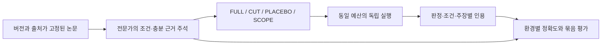

# LINK-DELTA 연구 제안

> 가제: **LINK-DELTA: Benchmarking Condition-Aware Evidence Revision in Scientific Literature QA**
>
> 목표: NeurIPS 2027의 벤치마크·평가 트랙. 문서 기준일 2026-10-22.
>
> 이 문서는 독립적인 연구 설계 제안이다. 아래 가설·목표 표본 수·예상 기여는 아직 실험으로 입증되지 않았다. 선행연구에서 확립된 요소와 이번 제안의 차이를 [관련 연구](RELATED_WORK.md)에 구분했다.

## 1. 내가 추천하는 논문의 중심

**“논문을 잘 찾아 인용하는 시스템도, 서로 다른 실험 조건의 결과를 잘못 이어 붙이거나 핵심 근거가 없어진 뒤 기존 결론을 유지할 수 있다. 기존 정적 QA 점수는 이 실패를 얼마나 가리는가?”**를 연구 질문으로 삼자.

LinkPaper를 더 좋은 논문 챗봇으로 만드는 것과, 좋은 벤치마크 논문을 만드는 것은 구별해야 한다. 후자는 어떤 능력을 측정하는지, 정답이 왜 신뢰할 만한지, 기존 평가로 무엇을 놓치는지 증명하는 작업이다. 새 GraphRAG 기법이나 SOTA는 필수 조건이 아니다. 2026년 공식 CFP도 평가 설계·감사·실패 분석을 기여로 인정한다. [공식 CFP](https://neurips.cc/Conferences/2026/CallForEvaluationsDatasets).

추천하는 평가 단위는 단일 QA가 아니라 **같은 질문과 실제 논문 근거로 만든 네 가지 근거 환경 묶음**이다. 핵심 조건을 만족하는 근거, 그 근거를 제거한 환경, 무관한 부분만 제거한 환경, 주제는 비슷하지만 조건이 다른 실제 근거를 넣은 환경에서 답변의 상태·조건·인용을 함께 본다.

이 제안의 독창성 후보는 단순한 “반사실적 RAG 평가”가 아니다. **논문 간 실험 조건의 호환성, 대체 가능한 충분 근거 집합, 근거 환경에 따른 결론 변경을 함께 주석하고 검증하는 측정 설계**다. 이 조합도 가까운 연구의 부록·코드와 대조해야 한다. 현재 검색 결과만으로 최초라고 주장하지 않는다.

## 2. 현재 레포가 주는 출발점

| 재사용할 것 | 연구에서 맡을 역할 | 바로 해결되지 않는 것 |
|---|---|---|
| HF Papers 수집·PDF 변환·섹션 청킹 | 후보 코퍼스 수집 및 근거 위치 확보 | HF 인기 논문 편향, PDF 오류, 부록 누락 |
| Neo4j Paper–Chunk–CITES 구조 | 선행·후속 논문 후보 탐색 | 인용은 지지/반박 관계의 정답이 아님 |
| Qdrant·공통 청크 ID·임베딩 출처 | 검색 베이스라인과 근거 재현 | 논문 버전별 시간 스냅샷은 별도 필요 |
| 평가 러너·manifest·근거 저장 | 결과 추적과 재채점 | 현재 계약은 gold와 시스템 입력을 엄격히 분리하지 않음 |
| offline/Ragas testgen | 수집·매핑 경로의 검증 및 후보 생성 | 전문가가 확인한 논문용 정답을 대체하지 못함 |
| 프런트엔드 논문 뷰어·인용 UI | 후속 주석 도구의 출발점 | 현재는 목업 중심이며 QA API 연동 미완성 |

특히 현 `graphrag_hybrid`는 검색 후 첫 문장을 이어 붙이는 타깃이다. LLM이 답을 만드는 `vector_rag`와 그대로 생성 성능을 비교하면 생성기 차이가 섞인다. “GraphRAG가 더 좋다”를 논문 전제로 두지 않는다. 자세한 근거는 [코드 감사](REPOSITORY_AUDIT.md)를 참조한다.

## 3. 아이디어 후보와 선택 이유

아래 평가는 문헌·코드에 근거한 연구 판단이며 실험 결과가 아니다.

| 후보 | 핵심 질문 | 중복·실행 위험 | 판단 |
|---|---|---|---|
| A. 과학 논문 멀티홉 QA | 인용을 따라 여러 논문을 찾는가? | AgentHop, SciNet, ScholarQABench와 매우 가까움 | 단독 주제로 비추천 |
| **B. 조건을 보존한 근거 변경 평가** | 근거의 필요성과 적용 범위를 구별해 결론을 바꾸는가? | 근거 제거·충실도 평가 자체는 기존 연구. 조건 주석의 신뢰도가 관건 | **주력 파일럿** |
| C. 근거 계보를 통한 중복 지지 평가 | 여러 인용이 실제로는 같은 원 실험을 재인용한 것인가? | 계보 주석이 비싸고 독립 실험 판정이 어려움 | B의 분석 또는 후속 주제 |
| D. 시점별 연구 결론 갱신 | 새 논문이 나왔을 때 과거 결론을 수정하는가? | SciConBench·PreScience 등과 비교 필요. 진짜 결론 변경 사례 수집이 느림 | 제한된 추가 검증 |
| E. 그래프 토폴로지와 평가 편향 감사 | 특정 생성 방식이 그래프 검색에 유리한가? | STaRK·AgentHop과 차별적인 체계적 감사가 필요 | B가 성립하지 않을 때 전환 후보 |

선택 이유는 B가 LinkPaper의 수집·검색 자산을 활용하면서도, 평가의 핵심을 특정 검색 아키텍처의 승리에서 분리하기 때문이다. 모든 모델이 잘 풀거나 전문가가 정답에 합의하지 못하면 방향을 바꿔야 한다.

## 4. 먼저 제한할 연구 범위

첫 버전은 **영어로 작성된 ML 논문 본문을 이용한, 조건이 명시된 경험적 주장 검증과 짧은 설명**으로 제한한다. NLP, CV, ML systems 세 하위 분야를 목표로 하되, 파일럿은 팀이 실제로 검수할 수 있는 두 분야부터 시작한다. “모든 과학 분야의 연구 능력”을 주장하지 않는다.

평가 대상은 **텍스트 입력·출력의 LLM**으로 고정한다. VLM 과제·멀티모달 근거는 다루지 않는다. Claude·Gemini·GPT API는 텍스트 모드로 평가하고, 오픈소스 로컬 모델은 비전·오디오 구성이 없는 CausalLM을 사용한다. API 모델의 내부 아키텍처까지 텍스트 전용이라는 주장은 하지 않는다. 실행 구현은 [텍스트 LLM 실험 안내](../../../evaluation/RESEARCH.md)에 연결했다.

좋은 질문은 “어떤 방법이 전반적으로 더 좋은가?”보다 다음에 가깝다.

> 주어진 논문 집합은 방법 A의 개선이 데이터셋 D의 평가 분할 S와 학습 예산 B에서도 유지된다는 주장을 뒷받침하는가? 확인된 조건과 부족한 비교를 근거와 함께 설명하라.

조건 튜플의 후보는 `task / dataset / split / metric / metric_direction / model_scale / training_data / compute_budget / evaluation_protocol / time`다. 모든 필드를 항상 요구하지 않는다. 각 질문에서 결론을 바꾸는 핵심 조건을 전문가가 지정하며, 알려지지 않은 값은 `unknown`으로 둔다. 누락 값을 임의로 동등하다고 처리하지 않는다.

주장 유형은 세 가지로 시작한다.

1. **조건부 성능 주장:** 같은 비교 조건에서 개선이 관찰되었는가?
2. **한계 해결 주장:** 후속 연구의 결과가 원 논문의 특정 한계를 실제로 다루는가?
3. **범위 확장 주장:** 한 조건의 결과를 다른 조건으로 일반화할 직접 근거가 있는가?

2·3번은 판정이 더 어렵다. 숫자 비교가 단순한 1번만으로도 측정 타당성을 먼저 확인하고, 전문가 합의가 확보된 유형만 본 실험에 포함한다.

## 5. 과제와 정답 정의

입력은 질문 `q`, 선택 논문 `p`, 접근 가능한 근거 코퍼스 `C_w`, 평가 시점 `t`다. 답변은 다음을 포함한다.

- `verdict`: `supported`, `refuted`, `mixed`, `insufficient` 중 하나.
- 조건을 명시한 짧은 답변과 원자적 주장 목록.
- 각 주장에 대응하는 실제로 읽은 논문 버전·근거 span.
- 결론을 제한하는 조건 및 필요한 추가 근거.

라벨은 **공개된 과제 코퍼스와 명시된 조건 안의 근거 상태**다. 세상 전체의 최종 진리를 뜻하지 않는다. 코퍼스에 근거가 없다는 이유만으로 주장을 `refuted`로 만들지 않는다. 동일 조건의 지지와 반박이 함께 있으면 질·설계 차이를 검토해 `mixed`를 허용한다. 단순 인용 수 다수결은 쓰지 않는다.

`retrieval_scope`는 별도로 `selected` 또는 `global`이다. 근거가 부족한지와 어디를 검색해야 하는지는 다른 축이다. 현재 레포의 `unknown` scope를 `insufficient` 정답의 대용으로 사용하지 않는다.

### 5.1 네 가지 근거 환경

| 환경 | 바꾸는 것 | 정답의 예상 관계 | 검증할 능력 |
|---|---|---|---|
| **FULL** | 충분 근거와 자연스러운 방해 문서를 제공 | 전문가가 정한 기준 정답 | 기본 이해·검색 |
| **CUT** | 필수 전제의 모든 확인된 대체 근거를 차단 | 해당 결론을 유지할 수 없으면 `insufficient` 등으로 변경 | 근거의 필요성 |
| **PLACEBO** | 정답과 무관한 근거를 비슷한 분량만큼 제거 | 결론과 핵심 조건 유지 | 불필요한 변경 억제 |
| **SCOPE** | 필수 결과 근거를 주제는 유사하지만 핵심 조건이 다른 실제 논문의 근거로 교체 | 적용 불가를 짚고 결론 범위를 제한하거나 유보 | 조건 호환성 |

핵심 질문 텍스트는 네 환경에서 동일하게 유지한다. SCOPE의 교체 문서에는 실제 출처와 원래 조건이 유지된다. 논문 내용·수치·저자를 조작하거나, 다른 논문의 문장을 원 논문의 결과처럼 붙이지 않는다. 적용 불가를 명시한 뒤 다른 조건에서 성립하는 제한적 사실을 설명하는 답변도 rubric에서 허용한다.

SCOPE는 CUT과 동일하게 목표 조건의 대체 충분 근거를 차단한 뒤 조건 불일치 근거를 제공한다. 조건이 맞는 근거가 다른 경로에 그대로 남으면 별도 사례로 판정하거나 제외한다. PLACEBO도 단지 “관련 없어 보이는 문서”를 지우는 데 그치지 않고 충분 근거와 정답이 보존되는지 독립 검수한다.

FULL은 처음에 `supported` 또는 `refuted`처럼 해석이 명확한 사례를 우선한다. 원래 `mixed`인 사례의 CUT은 단순 유보가 아닐 수 있으므로 별도 확장 집합으로 다룬다. **변경 방향은 환경 이름으로 자동 부여하지 않고 각 환경마다 독립적으로 주석한다.**

### 5.2 핵심 난점: 한 문단을 지웠다고 근거가 없어진 것은 아니다

동일한 결과가 초록, 본문, 표 캡션, 부록, 다른 논문 및 중복 버전에 남아 있을 수 있다. CUT을 만들 때 단일 정답 청크만 지워서는 안 된다.

각 원자적 주장 `c`에 대해 전문가가 확인한 충분 근거 집합들의 모음 `S(c) = {S1, S2, ...}`를 기록한다. 하나의 `Sj` 안에서는 여러 span이 함께 필요할 수 있고, 서로 다른 `Sj`는 대안이다. 제거 집합 `R`은 모든 확인된 `Sj`를 적어도 한 곳씩 끊어야 한다. 모든 `j`에 대해 `Sj \ R`만으로는 충분하지 않음을 검수한다.

이것은 **주석된 유한 코퍼스 내의 충분성 검증**이다. 모든 가능한 추론과 문헌의 최소 근거를 완벽히 찾았다는 주장은 하지 않는다. BM25·dense·인용 탐색으로 잔존 근거를 다시 찾고, 독립 검수자가 반례를 발견하면 수정·제외한다. 발견되지 않은 대체 근거는 벤치마크의 주요 오차 요인으로 측정한다.

생성 단계에서 최종 시스템이 볼 수 있는 그래프·요약·캐시에도 제거된 결과가 남지 않게 해야 한다. span만 가리고 초록 요약이나 결과 테이블을 그대로 노출하면 CUT이 무효다.

### 5.3 설명용 예시 — 실제 논문 결과가 아님

가상의 자료 P1은 A가 `D / split-S / budget-B`에서 기준 방법보다 높았다고 보고하고, P2는 같은 조건에서 추가 반복 실험을 제공한다고 하자. P3는 A를 다른 데이터셋 `D2`에서 평가하고, P4는 관련 없는 구현 설명이다.

| 환경 | 관찰 가능한 근거 | 바람직한 반응 |
|---|---|---|
| FULL | P1 결과 + P2 반복 + P3 + P4 | 명시된 조건에서의 지지와 그 한계를 설명 |
| CUT | 해당 결과를 담은 P1·P2의 모든 대체 span 차단 | 주장에 필요한 비교 결과가 없다고 유보 |
| PLACEBO | P4만 제거 | FULL의 조건부 결론 유지 |
| SCOPE | P1·P2의 비교 결과 대신 P3의 실제 D2 결과 제공 | D2 결과로 D의 주장을 판단할 수 없다고 설명 |

이 예시는 라벨 논리를 설명할 뿐이다. 그대로 늘린 합성 예시를 논문용 과학 데이터로 발표하지 않는다.

## 6. 비교 가능한 두 실행 설정

**주 실험은 근거 패킷 설정**으로 시작한다. 모든 시스템이 환경별로 같은 근거와 같은 토큰 예산을 받는다. 필수 근거·방해 근거의 정체, gold 관계, 환경 이름은 숨긴다. 검색 실패와 근거 해석 실패를 구분하기 쉽고 저렴하다.

**보조 실험은 고정 코퍼스 검색 설정**이다. 동일한 환경의 코퍼스에서 keyword search, dense search, paper read, citation traversal을 허용하고 네트워크는 차단한다. 그래프를 쓰지 않는 시스템도 같은 전체 코퍼스에서 검색할 수 있다. 그래프를 따라가야만 정답이 나오도록 접근권을 설계하지 않는다.

각 환경은 새 프로세스 또는 격리된 캐시·대화로 실행한다. 네 환경의 순서는 무작위로 하고, 다른 환경의 답변을 알려주지 않는다. 근거 제거 후 이전 FULL의 대화나 retrieval cache를 재사용하지 않는다. 실제 연속 대화에서 결론을 고치는 설정은 별도의 후속 실험이다.



## 7. 데이터 구축 계획

### 7.1 표본 규모는 질문 수와 환경 수를 분리해 센다

제안 목표는 **기본 질문 600개 × 네 환경 = 실행 케이스 2,400개**다. 환경 변형 2,400개를 서로 독립인 질문 2,400개로 보고하지 않는다. 하위 분야당 200개를 목표로 하되, 약 60개 이상의 근거 계보·주제 묶음을 확보하고 실제 군집 수를 공개한다.

- 공개 개발용: 약 120개 기본 질문 / 480개 환경.
- 공개 평가용: 약 360개 기본 질문 / 1,440개 환경.
- 추가 보유 평가용: 약 120개 기본 질문 / 480개 환경. 주 기여는 공개 부분이다.

숫자는 표본 수 계획이다. 실제 분할은 근거 공유 군집을 우선하므로 정확한 비율이 달라질 수 있다. 파일럿은 이 본 평가 집합과 분리하며, 최종 규모는 관측된 군집 내 상관과 검정력 시뮬레이션으로 정한다. 권리 확인된 배경 논문은 3,000–10,000편을 계획 범위로 두고 불필요한 대규모 수집을 피한다.

### 7.2 수집과 주석 절차

1. 질문 작성자가 실제 논문 읽기·비교 중 생기는 질문을 적는다. 모델 오답만을 기준으로 질문을 고르지 않는다.
2. 원천별 공개·재배포 권리를 확인하고 버전·원문 해시·본문 변환기 버전을 고정한다.
3. 다른 주석자가 질문에 답하고, 필요한 조건·충분 근거 집합·반박 근거·부족한 전제를 기록한다.
4. LLM과 그래프는 후보 근거·질문 초안을 제안할 수 있다. 최종 과학적 관계는 전문가가 확인한다.
5. CUT의 잔존 근거 탐색과 SCOPE의 조건 차이 검수를 한다. 원 논문의 단순 인용을 실험적 지지로 간주하지 않는다.
6. 네 환경을 독립적으로 두 명이 주석하고, 불일치를 세 번째 검수자가 조정한다. 최초 판정도 보관한다.
7. 숫자·단위·분할·상한/하한·통계적 주장·비교 예산을 원문과 대조한다. 불명확한 사례를 억지 정답으로 만들지 않는다.
8. 제외 사유, 생성 모델, 사람이 고친 범위, 시간, 비용, 대체 근거 발견률을 공개한다.

라벨에는 Cohen’s kappa 또는 Krippendorff’s alpha와 원시 일치율을 보고한다. span과 충분 근거 집합은 별도의 일치율을 잰다. 목표 `alpha >= 0.75`는 내부 진행 기준이며 달성한 결과가 아니다. 모델 출력 평가용 rubric도 전문가 간 재현성을 확인해야 한다.

### 7.3 분할과 정보 누출

같은 질문의 모든 환경, 논문 버전, 근접한 질문 paraphrase는 같은 split에 둔다. 정답을 결정하는 논문을 공유하는 질문들은 군집으로 묶는다. 이를 단순 무작위 질문 분할로 대체하지 않는다. 연결이 너무 커지면 해당 계보를 통째로 한 split에 두거나 제외·별도 평가하며, 임의로 연결을 잘라 독립이라고 주장하지 않는다.

공통 배경 논문이 split을 넘을 수 있다면 그 범위를 명시하고, 정답을 결정하는 근거 논문과 구별해 중복률을 공개한다. 리뷰 논문·HF 요약·관련 작업 문단·표·부록·버전 중복에서 답이 새어 나오는지도 검사한다.

시점 평가는 `published_at <= t`만으로 충분하지 않다. **그 시점에 실제 공개된 버전**, 당시의 본문·참고문헌·메타데이터만 써야 한다. 현 레포의 `source_version`은 파싱 출처여서 arXiv v1/v2와 다르다. 모델의 비공개 학습 데이터까지 통제할 수 없으므로 최근 논문만으로 비오염을 보장한다고 쓰지 않는다.

## 8. 지표: 최종 답변과 근거 변경을 함께 측정

### 8.1 환경별 통과 판정

질문 `i`, 환경 `w`의 통과 여부 `V(i,w)`는 다음을 모두 만족할 때 1이다.

1. 근거 상태 라벨이 맞는다.
2. 사전 정의한 핵심 조건과 필수 원자적 주장을 충족한다.
3. 중요한 과장·조건 누락·근거와 반대되는 주장이 없다.
4. 실질적 주장에 환경 내에서 접근·확인한 충분한 근거를 인용한다.

유보 사례도 “모르겠다” 한마디로 통과시키지 않는다. 어떤 전제·조건의 근거가 부족한지 설명해야 한다. 단, CUT에서 사라진 gold span ID 자체를 정답 출력에 요구해서는 안 된다. 근거가 남아 있는 범위의 사실은 인용하고, 부재는 코퍼스 전체의 절대 부재가 아니라 제공된 근거로 판단할 수 없다는 형태로 표현한다.

구조화된 상태·조건 일치, 접근 로그·인용 ID 존재, 수치 허용 오차는 결정적으로 검사한다. 의미적 주장 충족과 지지는 전문가 rubric 및 보정된 judge로 평가한다. 임의의 어휘 겹침을 과학적 함의 판정으로 승격시키지 않는다.

### 8.2 주 보고값

| 지표 | 정의·용도 | 피해야 할 해석 |
|---|---|---|
| Verdict macro-F1 | 네 라벨의 환경별 분류 | 이것만으로 근거를 이해했다고 주장 |
| FULL pass | 충분 근거가 있을 때의 기본 성공률 | 쉬운 사례를 제외해 난도 인위 상승 |
| PairPass(j) | `mean_i V(i,FULL) * V(i,j)`, j는 CUT/PLACEBO/SCOPE | 원래 틀린 답변이 달라진 것을 개선으로 계산 |
| Joint4 | `mean_i product_w V(i,w)` | 네 환경을 독립 표본으로 간주 |
| Condition fidelity | 핵심 조건의 정확도·누락·부당 일반화 | 단어가 같다는 이유로 조건 동등 판정 |
| Claim–evidence precision/recall | 필수·생성 주장의 지지와 누락 | 인용 ID 존재를 의미적 지지와 동일시 |
| Coverage–risk curve | 답변한 비율에 따른 오류, 유보 성향 | 항상 유보하는 시스템을 최고로 평가 |

새로운 곱셈식 자체를 독창적인 수학적 기여라고 주장하지 않는다. 측정 대상과 데이터가 기존 평가에 추가하는 정보가 기여다. Joint4가 지나치게 희소하면 파일럿에서 PairPass와 전이 혼동행렬을 중심 지표로 확정하고 **본 테스트를 보기 전에 고정**한다.

인용 평가는 대안 충분 근거 집합을 허용한다. 예를 들어 gold가 `{a,b}` 또는 `{c,d}`라면 하나의 완전한 집합으로 답해도 통과할 수 있다. 두 집합을 합친 모든 span을 강제로 인용하도록 요구하지 않는다. 새로운 유효 근거가 발견되면 독립 검수 후 라벨 버전과 전체 시스템 점수를 함께 갱신한다.

### 8.3 통계와 평가기 검증

기본 질문보다 더 큰 **근거 계보·주제 군집** 단위로 paired bootstrap 95% 구간을 구한다. 환경별 변형을 별도 표본으로 재표집하지 않는다. 군집이 적으면 불확실성을 그대로 보고하고, 본 평가 전에 필요한 표본 수를 다시 계산한다.

핵심 비교와 오류 유형을 미리 정하고, 다중 비교는 보정하거나 탐색적이라고 명시한다. stochastic 시스템은 적어도 파일럿·대표 부분집합에서 3회 실행하여 실행 변동과 질문 변동을 구분한다. 실패·타임아웃·형식 오류는 주 지표에서 실패로 포함한다. judge 실패를 조용히 분모에서 빼지 않고 수동 보완 또는 결측 민감도 분석을 보고한다.

모델·환경·난도별 층화 출력 중 최소 200개를 전문가가 블라인드 평가하고, 서로 다른 계열의 judge 두 개와 일치율·오류를 비교한다. 자기 생성/자기 평가 편향과 위치·길이 편향도 확인한다. 200개는 초기 보정 규모 제안이며, 낮은 일치율이면 확대한다.

## 9. 꼭 필요한 베이스라인과 실험

### 9.1 동일 생성기로 검색 구조를 비교한다

| 비교군 | 역할 |
|---|---|
| Closed-book | 사전 지식 의존·암기 진단. 외부 근거를 못 봤으므로 근거 인용 점수는 별도 해석 |
| 동일 근거 패킷 + LLM | 근거를 읽고 조건을 판단하는 능력 |
| BM25 + 동일 LLM | 강한 어휘 검색 대조군 |
| Dense + 동일 LLM | 의미 검색 대조군 |
| BM25+dense+reranker + 동일 LLM | 그래프 없는 강한 하이브리드 대조군 |
| Citation expansion + 동일 LLM | 동일 후보·토큰 예산에서 인용 관계의 추가 가치 |
| Gold sufficient evidence + 동일 LLM | 실험자만 아는 oracle 진단. 제출용 현실 시스템과 구분 |
| 항상 지지 / 항상 유보 / 질문만 / 메타데이터만 | 라벨·길이·환경·질문 shortcut 탐지 |

문헌 시스템 비교는 OpenScholar, PaperQA2, SciRAG를 우선 검토한다. 재현 가능 구현·라이선스·입출력 계약을 확인한 뒤 고정 코퍼스에 맞춰 어댑트한다. 외부 검색을 금지하도록 바꾼 결과는 원 논문의 시스템과 동일한 성능 재현이라고 쓰지 않는다. 적응이 불가능하면 제외 이유를 공개하고, 검증되지 않은 재구현에 원 논문 이름만 붙이지 않는다.

모델은 실행 시점에 접근 가능한 open-weight와 closed API 계열을 각각 복수 선택하고 정확한 버전·추론 설정을 고정한다. 아직 존재하지 않거나 접근이 확인되지 않은 2027년 모델을 전제로 예산을 세우지 않는다. 주 아키텍처 비교는 같은 backbone으로 수행하고, 서로 다른 완성형 서비스 비교는 별도 표에 둔다.

### 9.2 결과와 관계없이 답해야 할 연구 질문

| RQ | 실험 | 허용되는 결론 |
|---|---|---|
| RQ1. 정적 정확도와 환경 변화 대응은 같은가? | FULL 순위와 PairPass·Joint4 순위 및 expert 오류의 관계 | 같으면 차별적 진단 가치가 약하다는 결과도 보고 |
| RQ2. 조건이 다른 근거에 속는가? | SCOPE와 진짜 조건 일치 대조, 문서 길이·어휘 난도 통제 | 조건 불일치 유형별 관찰 결과 |
| RQ3. 핵심 근거와 무관한 문서를 구별하는가? | CUT vs PLACEBO, 원래 정답일 때의 변경 방향 | 근거 환경에 대한 행동적 의존성. 내부 추론의 인과 증명은 아님 |
| RQ4. 그래프가 실제로 도움을 주는가? | 동일 생성기·근거 토큰·검색량에서 graph on/off | 그래프가 불리하거나 무효여도 유효한 결과 |
| RQ5. 새 지표가 연구자 판단에 유용한가? | 기존 점수와 새 점수의 전문가 오류 예측 비교 | 독립 expert labels를 더 잘 설명하는지 검증 |

추가 실험은 실제 공개 시점이 다른 두 문헌 스냅샷에서 조건부 결론이 달라지는 **자연적 갱신** 사례 30–60개다. 충분한 사례가 없으면 본 기여로 넣지 않는다. 새 논문이 항상 옳거나 과거 결론을 반박한다고 가정하지 않는다.

### 9.3 환경 차이 자체가 정답 힌트가 되지 않게 한다

환경 이름·제거 로그·gold graph·필수 근거 표시를 모델 입력에 넣지 않는다. 내부 평가용 manifest와 모델이 읽는 입력 파일은 분리한다. 사례 ID는 의미 없는 값을 쓰고 환경별 길이·문서 수·출처 노출 분포를 맞춘다. 무의미한 padding으로만 맞추지 말고 실제 비관련 문서와 부분집합 매칭을 사용한다.

환경별로 원문 전체를 물리적으로 복제할 필요는 없다. 불변 archive와 환경별 접근 가능한 span 목록을 두되, 검색 인덱스·읽기 도구·자동 요약이 그 목록 밖의 내용을 반환하지 못하도록 한다. 제거 표시나 연속 chunk 번호도 shortcut이 될 수 있어 공개 ID를 재매핑하고 placebo의 결손 패턴과 대조한다. 그래프 입력에는 원문에서 추출 가능한 관계만 제공하며, 전문가 gold의 `supports/refutes` 관계를 검색기에 노출하지 않는다.

한 시스템의 retriever로 질문을 만들고 그 시스템에 유리한 gold를 정하지 않는다. 그래프 연결로 만든 질문과 연구자가 직접 작성한 질문의 성능을 따로 비교한다. 그래프가 없는 시스템에도 동등한 검색권을 준다.

## 10. 레포를 어떻게 확장할 것인가

아래 경로는 **제안하는 후속 구현 위치**이며 이번 문서 브랜치에서 구현했다고 뜻하지 않는다.

```text
evaluation/
  research_bench/
    contracts.py          # gold를 담지 않는 TaskInput과 별도 GoldRecord
    evidence_sets.py      # 대안 충분 근거와 조건 계약
    worlds.py             # 불변 코퍼스의 접근 가능 근거 집합
    audit.py              # 잔존 근거·조건 차이·분할·shortcut 검사
    paired_runner.py      # 환경별 격리, 군집 ID, 실패 포함 집계
    claim_judge.py         # 주장별 rubric, human/judge 보정 기록
  configs/research/       # 동일 backbone/예산의 비교 설정
indexing/
  ...                     # raw source archive, arXiv version, parser provenance 추가
```

현 `EvalCase`를 모든 새 필드로 덮어쓰는 대신 버전이 있는 별도 연구 계약과 기존 러너 어댑터를 권한다. `extra="ignore"`인 모델은 새 연구 필드를 조용히 버릴 수 있으므로 “JSONL에 적었으니 평가됐다”는 오류를 막아야 한다. 더 중요한 문제는 `EvalTarget.run(case)`가 gold를 포함한 전체 case를 받는다는 점이다. 새 경계는 `TaskInput`만 시스템에 전달하고 gold는 evaluator 프로세스에 남겨야 한다.

`as_of`, `paper_version`, `license`, `source_hash`, `span_offsets`, `condition_key`, `evidence_set_id`, `family_id`, `world_id`, `annotation_version`, `rubric_version`을 연구용 manifest에서 관리한다. `world_id`와 gold 집합은 시스템 입력으로 노출하지 않는다. 원문과 정규화 span 좌표의 대응도 보존한다.

논문용 실행은 격리된 DB·파일 인덱스를 쓰고, live 서비스 데이터에 `seed`·`reset`을 실행하지 않는다. 매 환경이 동등한 원본에서 재생성되는지 해시와 접근 로그로 확인한다.

## 11. 출처·저작권·기존 기여의 경계

원 레포는 `linkmind-ai/linkpaper`의 fork이고 MIT 고지 및 기존 기여자 이력을 유지한다. LinkPaper 전체 코드나 기존 평가 모듈을 이번 논문의 독자적 발명으로 주장하지 않는다. 새 기여는 질문, 조건·근거 주석, 검증된 개입 집합, 측정 프로토콜, 실증 분석으로 구체화한다.

논문 원문이 웹에서 읽힌다는 사실과 재배포 권리는 다르다. 원문별 라이선스를 기록하고, 재배포 가능한 소스로 공개 핵심 코퍼스를 구성한다. 코드 MIT가 논문 PDF나 텍스트까지 포괄하지 않는다. 제한된 원문은 무단 복사하지 않고 허용 범위의 식별자·수집 코드·주석을 제공하되, **제3자가 접근·재현하지 못하는 자료가 주 공개 기여가 되지 않게** 한다. 데이터 라이선스는 실제 원천 조합 확인 후 정한다.

기존 벤치마크 문항·정답·설명문은 새 데이터로 바꾸어 부르지 않는다. 기존 기법과 지표는 명시적으로 인용하고, LLM 사용 범위 및 인간 검수 과정을 기록한다. 저자·기여 구분은 실제 연구 참여를 기준으로 정한다.

2026년 기준 재사용 가능한 실행형 벤치마크는 제출 시 실행 가능한 코드·데이터 접근, 장기 호스팅, Croissant core 및 RAI 메타데이터를 준비해야 한다. 2027년에는 해당 연도 CFP를 다시 확인한다. [공식 hosting 지침](https://neurips.cc/Conferences/2026/EvaluationsDatasetsHosting).

## 12. 논문이 강해지기 위한 증거와 중단 기준

강한 논문이 되려면 다음 세 가지가 함께 필요하다.

1. **측정 타당성:** 전문가가 조건·충분성·환경별 정답에 재현 가능하게 합의한다.
2. **추가 진단 가치:** 정적 QA와 인용 점수만으로 설명되지 않는, 연구자에게 중요한 오류를 찾는다.
3. **재사용성:** 외부 연구자가 같은 입력·권리·실행 계약으로 자체 시스템을 평가할 수 있다.

“모델이 낮은 점수를 받았다”, “질문이 많다”, “GraphRAG가 이겼다” 중 하나만으로는 충분하지 않다. 차이가 예상과 반대여도 보고한다. 성능을 낮추기 위해 모호한 문항이나 외부에서 확인할 수 없는 사실을 넣지 않는다.

파일럿에서 조건 판정 합의가 낮거나 CUT에 대체 근거가 자주 남으면 과제를 좁힌다. 전문가에게 분명하지만 모델도 대부분 푸는 과제라면 대표성 있는 측정 도구로 가치가 있는지 검토하고, 상위권 논문을 위해 난도만 임의로 높이지 않는다. 가까운 선행연구가 같은 프로토콜과 공개 데이터를 이미 제공한다면 이름 변경 대신 기여 자체를 재설계한다.

## 13. 논문 구성 초안

| 부분 | 담을 내용 |
|---|---|
| Introduction | 같은 정적 정답 점수로는 드러나지 않는 조건·근거 사용의 차이 |
| Related Work | AgentHop/SciNet/ScholarQABench와 faithfulness·sufficiency 연구의 명시적 경계 |
| Measurement Target | 코퍼스 상대적 정답, 조건 호환성, 대안 충분 근거, 행동적 환경 변화 대응 |
| Dataset | 수집·권리·주석·독립 검수·분할·오류·제외 통계 |
| Protocol | 네 환경, 패킷/검색 설정, 동일 예산, 지표, 군집 통계 |
| Experiments | 강한 비그래프 대조군, 문헌 시스템, oracle, shortcut, human/judge 검증 |
| Analysis | 실제 오류 사례, 조건별 차이, 대체 근거와 시간·비용, 기존 점수의 설명력 |
| Limitations & Release | CS 범위·불완전 근거 주석·학습 오염 불확실성·공개 유지 계획 |

현재 수치가 없는 초록을 결과가 있는 것처럼 쓰지 않는다. 첫 2주 동안은 [로드맵](ROADMAP.md)의 파일럿으로 중심 가설과 데이터 제작 가능성을 검증하는 것이 우선이다.
