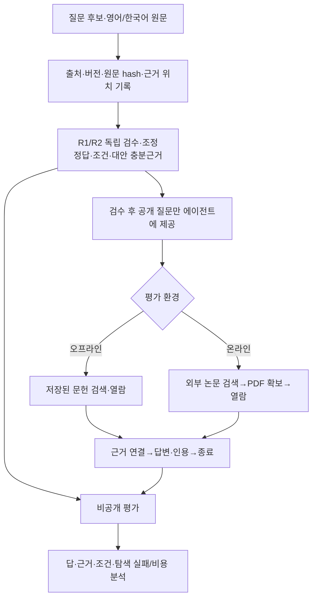

# 팀원용 데이터 수집·라벨링 안내

## 0. 2분 OT: 논문 아이디어와 벤치마크 흐름

**연구 질문:** 필요한 논문 수를 알려주지 않을 때, 에이전트가 한 논문 또는 여러 논문의 **방법·조건·수치·결과 근거를 스스로 찾아 연결**하고, 근거가 충분한 시점에 답을 낼 수 있는가? 영어 논문을 더 많이 포함하되 한국어 논문도 모으며, AI 이외 분야도 다룬다. 예를 들어 서로 다른 논문의 성능 숫자를 비교할 때 데이터셋·모델·평가 절차가 같은지도 확인해야 한다. 결과의 재보고와 새 결과를 구별하는 과제는 전체 중 한 하위 유형이다.

**논문 가설:** 정답만 맞았는지 보면 문헌 발견·확보·근거 연결·종료 중 어디서 실패했는지 놓칠 수 있다. 같은 질문의 오프라인/온라인/기록 재현 조건을 비교해 이 실패를 분리해 보려는 설계이며, 아직 실험 결과로 입증한 주장은 아니다.



| 평가 항목 | 무엇을 확인하나 | 현재 상태 |
|---|---|---|
| **답 정확성·의미 품질** | 단답·수치·설명·판정형에 맞는 답과 조건의 의미가 맞는지 검수 | 현재 온라인 예시는 `scientific_semantic_accuracy=null`; 단순 문자열 일치는 과학적 정답 점수가 아님 |
| **근거 연결** | 실제 열람·인용(`citation_read_validity`), 알려진 대안 중 충분근거 조합 확보(`sufficient_evidence_coverage`), 조건 일치 | 구조 진단은 구현됨. 조건 문자열 일치(`condition_recall`)만으로 의미상 맞는 조건인지 인증하지 않음 |
| **탐색·획득·종료** | 검색·PDF 확보·파싱 실패, 필요한 근거 누락·조기 종료, 도구 호출·시간·토큰/비용 | 실패한 예정 문항도 분모에 남겨 단계별로 보고. 온라인 예시는 실제 수집 절차 확인이며 LLM 성능 결과가 아님 |
| **GLRS: 결과 원천 하위 과제** | 같은 결과의 재보고에는 흔들리지 않고 새 결과에는 반응하는 근거 그룹·인용 품질 | [후보 지표](../docs/research/korean-agent-20261102/METRICS_KO.md). 전체 과제의 점수가 아니며 사람 평가와 대조한 타당성 검증이 필요 |

GLRS 후보식은 `C × min(G_B, G_R, G_N) × I × S × A`다. B/R/N은 기준·재보고·새 결과 조건이며, `G`는 근거 그룹 품질, `I`는 반복 유지, `S`는 새 결과 반응, `C`는 주장 인증, `A`는 실제 새 원천 취득을 뜻한다. 상세 정의와 한계는 위 지표 문서에 있다.

오프라인은 저장된 문헌에서 시작하고, 온라인은 같은 에피소드 안에서 외부 논문을 찾아 확보한다. **현재 자동 온라인 제공자는 arXiv API/PDF**이며 일반 웹 전체를 검색하는 구현은 아니다. 질문·필요 문헌 수·정답 근거의 공개 범위와 실제 실행 절차는 [과제 정의](../docs/research/korean-agent-20261102/TASK_SUITE_KO.md)와 [접근 모드](../docs/research/korean-agent-20261102/ACQUISITION_TRACKS_KO.md)에 적었다.

### 위 연구 질문을 실제로 풀면

출제자는 원문을 확인해 질문과 모범 답, 답을 뒷받침하는 근거 위치·조건·허용 가능한 **대안 근거 조합**을 따로 적는다. 에이전트에게는 질문·언어·도구 설명·예산을 주고 필요한 논문 수나 정답 근거 목록은 알려주지 않는다. 문항에 따라 한 논문의 여러 부분을 읽거나 여러 논문을 연결한다. 방법·조건·수치·결과는 가능한 근거의 예시이며, 매 문항에서 네 종류를 전부 요구한다는 뜻은 아니다.

예를 들어 [OFF-001](examples/offline/OFF-001/)은 69.3%와 81.15%의 우열을 묻는다. 두 숫자만 보면 81.15%가 커 보이지만, 원문에서는 평가 데이터셋·인코더·모델 선택 절차가 다르다. 따라서 각 숫자의 **측정 조건을 논문 사이에서 연결**해야 직접 승패를 말할 수 없다는 답에 도달한다. 예시의 근거 조합은 수작업 검수 전 교육용 초안이며, 가능한 모든 해결 경로의 절대 최소 논문 수를 증명하지 않는다.

| 코드 위치 | 현재 구현된 역할 |
|---|---|
| [공개 질문·비공개 정답 계약](../evaluation/src/linkpaper_eval/agent_bench/contracts.py) | `PublicTask`는 질문·언어·ID만 담고, `Case.gold.sufficient_sets`와 과제 유형은 평가자 쪽에 둔다. |
| [오프라인 도구](../evaluation/src/linkpaper_eval/agent_bench/environment.py) | 고정된 JSONL 근거 기록을 `search`·`open`·`citations`로 탐색한다. 검색 대상에는 관련 자료와 방해 자료가 함께 있을 수 있다. |
| [온라인 수집](../evaluation/src/linkpaper_eval/paper_acquisition.py)·[온라인 실행](../evaluation/src/linkpaper_eval/live_paper_bench.py) | 현재 arXiv에서 `search_papers`→`fetch_paper` 후 `search_local`·`open`을 수행한다. 정책이 예산 내에서 검색·확보·열람을 반복할 수 있다. |
| [종료 선택](../evaluation/src/linkpaper_eval/agent_bench/runner.py)·[채점](../evaluation/src/linkpaper_eval/agent_bench/scoring.py) | 정책이 다음 도구 호출 대신 `Answer`를 내면 종료한다. 실행 중 정답 근거 수를 알려주는 신호는 없고, 제출 후 실제 열람·인용과 비공개 충분근거 조합을 대조한다. |

**현재 구현 범위:** 오프라인 통합 예제는 가상 JSONL이고 이 폴더의 실제 논문 CSV는 아직 독립 검수 전이며 평가 입력으로 자동 변환되지 않는다. 온라인 예시 3건은 실제 arXiv 검색·PDF 확보를 수행한 scripted 절차 확인으로, 여러 논문을 자율 선택해 정답을 낸 LLM 실험은 아니다. “충분한 시점에 멈추기”는 평가하려는 능력이다. 조기 종료는 근거 부족으로 드러날 수 있지만, “정확히 최적 시점에 멈췄는가”를 검증한 단일 점수는 아직 없다. 기존 서비스의 [논문 검색 API](../backend/src/linkpaper/api/routes/papers.py)도 현재 501 상태다.

김수용·정상헌·남두현·오창원·이상민이 기존 서비스 직무와 별개로 아래 일을 분담한다.

## 1. 먼저 볼 모범 수집 예시

이 폴더에는 **오프라인 3개 + 온라인 3개 = 수집 packet 6개**가 있다. packet 하나는 질문 하나와 그 근거 자료 묶음이다. 논문 한 편과 같지 않다. 같은 문항의 offline/live/replay 실행도 별도 기본 문항으로 더하지 않는다.

| 예시 | 수집 방식 | 무엇을 배우는가 |
|---|---|---|
| [OFF-001](examples/offline/OFF-001/) | 저장된 영어 AI 관련 논문 묶음 | SimCLR와 Wang·Isola 문헌의 평가 조건을 연결해 직접 비교 가능한지 확인 |
| [OFF-002](examples/offline/OFF-002/) | 저장된 영어 생물다양성 논문 | 같은 대상의 예측·등록 종수와 단위를 맞춰 계산 |
| [OFF-003](examples/offline/OFF-003/) | 저장된 한국어 형태소 분석 논문 | 모델 설정·데이터 규모·표 성능을 여러 위치에서 연결 |
| [ON-001](examples/online/ON-001/) | 실제 arXiv 검색: Understanding Batch Normalization | 검색어·후보·버전·다운로드·열람·replay 기록 방법 |
| [ON-002](examples/online/ON-002/) | 실제 arXiv 검색: 쌍성 블랙홀 합병의 중력파 관측 | 비AI 물리 분야에서 같은 절차를 적용하고 원문 위치를 확인 |
| [ON-003](examples/online/ON-003/) | 실제 arXiv 검색: Earth's Energy Imbalance and Implications | 기후·에너지 자료의 버전·값·권리·추출 상태를 사실대로 보존 |

전체 목록과 상태는 [examples_index.csv](examples_index.csv)에서 확인한다. 각 예시의 `public_questions.csv → sources.csv → evidence.csv → reference_answer.csv → collection_log.csv` 순서로 읽는다. 온라인 예시에는 실제 질의를 적은 `search_trace.csv`가 추가된다. 모범 작성은 교육용 초안이며 사람 2인 검수가 끝난 gold가 아니다. 온라인 scripted 실행도 LLM이 연구 질문에 정답을 냈다는 증거가 아니다.

원문은 `sources.csv`의 공식 PDF URL에서 확보한 뒤 SHA256을 대조한다. 브랜치에는 필요한 CSV 예시를 담고 raw PDF·전체 추출문은 넣지 않았다. 저장소 기준 원문 경로는 이 작업 환경의 로컬 위치이므로 팀 환경이 다르면 실제 저장 위치를 따로 기록한다.

## 2. 사람별 할 일과 초기 분량

이 안내에서 **후보 1개는 ‘질문 아이디어 + 관련 source URL을 묶은 candidate packet’**이다. 논문별 서지정보는 `sources.csv`에 따로 한 행씩 적는다. 검색 API hit·중복 버전·같은 후보의 다른 검색어를 서로 다른 후보로 부풀리지 않는다. 원시 hit 수와 중복 제거한 source/후보 수를 모두 남긴다.

후보 초기에는 [candidate_screening.csv](templates/candidate_screening.csv)에 질문 아이디어·시작 URL·예상 연결 근거·선정/보류 이유부터 적는다. 32개 모두 완성 gold를 만들라는 뜻이 아니며, 그중 판정 가능한 자료를 정밀 수집·검수한다.

| 사람 | 최초 후보·정밀 작성 목표 | 우선 탐색 영역(조정 가능) | 공통 수집 외 추가 책임 |
|---|---|---|---|
| **김수용** | 후보 32개 → 기본 문항 8개 | AI·컴퓨터 | 질문·답 유형·근거 연결 기준, 전체 protocol·논문 주장 통합 |
| **정상헌** | 후보 32개 → 기본 문항 8개 | 물리·화학 | URL·버전·원문 hash·이용조건·수집 로그 점검 |
| **남두현** | 후보 32개 → 기본 문항 8개 | 재료·기계·에너지 | 실험 조건·단위·분모·표/각주 대응 기준 |
| **오창원** | 후보 32개 → 기본 문항 8개 | 환경·토목 | 한국어 질문의 명확성·영어 대응·타당한 대안 근거 |
| **이상민** | 후보 32개 → 기본 문항 8개 | 비임상 생명·농업 | source family·버전 중복·split 누출·검수 통계 |

32→8은 인력 계획이며 실제 25% 통과를 보장하는 비율이 아니다. 분야는 전문성을 이름으로 추정해 확정한 배정이 아니다. 읽고 판정하기 어려우면 `분야 검토 필요`로 보류하고 담당·분야를 조정한다. 영어 다수/한국어 포함은 전체 원천 구성 목표이며 사람별 문항 수를 특정 언어 quota로 바꾸지 않는다.

각 사람의 8개는 **오프라인에서 먼저 만든 4개 + 온라인 발견에서 출발한 4개**를 초기 목표로 한다. 가능한 문항은 같은 질문·버전·정답으로 두 모드에 모두 준비하되 하나의 `base_case_id`를 유지한다. 현재 온라인 provider로 확보할 수 없는 한국어 발행처 등의 문항은 offline-only/온라인 보류 사유를 기록하며 억지로 짝을 만들지 않는다. 총 기본 문항 목표는 5명×8=40개이며 모드별 실행 수와 구분한다.

각자 3종 이상의 주요 과제 유형을 우선 시도한다. 유형은 **단일 논문 내 연결 / 논문 간 연결 / 조건 비교 / 수치 추론 / 상충·정보 부족 / 결과 원천**이다. 결과 원천만 모으거나 특정 사람이 한 유형을 전담하지 않는다. 확보하지 못한 유형은 이유를 적고 실제 분포를 보고한다.

목표와 순환 검수 배치는 [assignments.csv](templates/assignments.csv)에도 담았다. 숫자는 계획이지 완료 건수가 아니다.

## 3. 오프라인: 이미 저장된 논문에서 시작

1. 저장된 PDF를 골라 제목·공식 URL·실제 버전·본문 언어·이용조건을 확인한다. 논문을 복사하기 전에 같은 DOI/원고 family가 이미 있는지 확인한다.
2. 질문 아이디어를 직접 작성한다. 표 한 셀만 복사하는 문제보다 **방법/정의 + 조건/데이터 + 표/본문 결과**처럼 필요한 근거를 연결한다. 관련 논문이 필요하면 실제 연결 관계부터 확인한다.
3. `sources.csv`에 원본 SHA256을 적고, `evidence.csv`에는 PDF 쪽·표·행·열/절·문단·조건·값·근거 역할을 적는다. PDF viewer의 쪽수와 인쇄 쪽수는 구분한다.
4. `reference_answer.csv`에 모범답·추론 단계·의존관계·계산식·허용 대안 근거를 적는다. 예측값을 실측으로, 파라미터 비율을 정확도로 바꾸지 않는다.
5. `collection_log.csv`에 실제로 확인한 자료·작업·시각·보류/제외 이유를 기록한다. 다운로드만 끝난 상태를 문항 완성으로 표시하지 않는다.

## 4. 온라인: 검색부터 실제 기록

현재 자동 경로는 **arXiv API/PDF**다. Google·Brave·Tavily 일반 웹 검색이나 모든 한국어 발행처를 지원한다고 기록하지 않는다. 공식 발행처를 사람이 추가 탐색했다면 자동 실행과 분리해 그 URL·접근 방법을 기록한다.

1. 질문 아이디어와 검색어를 먼저 적고 외부에서 실제 후보를 찾는다. 검색 순위·제목·URL·arXiv ID/버전·검색 시각·raw 응답 hash를 `search_trace.csv`에 기록한다. 검색 hit가 곧 쓸 수 있는 근거는 아니다.
2. PDF 확보 후 파일 hash·바이트·페이지·parser 버전·cache 상태·성공/실패를 저장한다. 실패도 지우지 않는다. 추출문만 보지 말고 원본 페이지와 표·단위를 확인한다.
3. 오프라인과 같은 source/evidence/reference CSV를 채운다. 아직 원문 답을 검증하지 않았다면 모범답을 만들어 넣지 말고 검수 대기로 둔다.
4. 아래 연결 확인 명령은 scripted policy다. 실제 모델 실험은 `run --policy module:factory`로 별도 수행한다. `--max-fetches 1`은 자원 상한이며 정답에 필요한 논문 수가 아니다.

과거 기록에 정확한 검색 UTC가 없으면 **시각 칸은 빈칸(미기록)**으로 두고 `시각근거`에 그 이유를 적는다. 파일 mtime을 관측했다면 별도 칸에 적고 실제 검색 시각처럼 바꾸어 쓰지 않는다. 아래 질문·검색어는 자신의 후보에 맞게 바꾼 뒤 실행한다.

```bash
# 저장소 루트에서 실행. collection_run은 매번 새로운 경로로 지정한다.
collection_run="evaluation/runs/team-collector-case001"
CUDA_VISIBLE_DEVICES='' uv run --project evaluation --frozen --extra acquire \
  python -m linkpaper_eval.live_paper_bench run-demo --provider arxiv \
  --question '직접 작성한 연구 질문' --query '실제 검색어' \
  --max-searches 1 --max-fetches 1 --max-calls 8 --out "$collection_run"
uv run --project evaluation --frozen python -m linkpaper_eval.live_paper_bench replay \
  --run-dir "$collection_run"
```

replay는 기록된 도구/인용을 네트워크 없이 재검증하는 것이며 새 모델 평가가 아니다. PDF를 가져왔다는 사실이나 구조 점수 1.0을 과학적 정답·gold로 표시하지 않는다. 수집은 CPU로 가능하며 GPU/모델 가중치가 필요하지 않다. 실제 GPU 모델 실험이 필요하면 이 호스트에서는 사용자 지시대로 물리 GPU3만 사용한다.

## 5. 질문 공개본과 검수본을 분리

`public_questions.csv`에는 **문항ID·질문·질문언어 3개 필드만** 둔다. 필요한 논문 수, 정답 source 목록, task tag, 충분근거 조합·모범답·예상 경로를 넣지 않는다. 논문 수가 힌트가 되는 파일명/문항 ID도 피한다.

나머지 CSV는 교사/검수자용이다. 숫자·단답·설명형에 `supported`를 일괄 부여하지 않는다. 판정형에서만 지지/반박/혼재/정보 부족을 붙이고 설명형의 유보는 이유를 적는다. 방법·조건 근거에는 결과 unit ID를 억지로 붙이지 않으며 GLRS는 결과 원천 하위 유형에만 적용한다.

`E1+E2|E3+E4`처럼 타당한 충분근거 조합의 대안을 남긴다. 각 조합의 고유 논문 수는 private 기록이다. **현재 검수한 대안의 논문 수는 전 세계 가능한 해결 경로의 절대 최소 논문 수 증명이 아니다.** 새로운 유효 대안은 어느 모델이 냈는지 가리고 검수한 뒤 버전을 갱신하고 전체 영향을 재채점한다.

## 6. 제출과 독립 검수

빈 파일은 [templates/offline/](templates/offline/) 또는 [templates/online/](templates/online/)를 문항별로 복사한다. 모든 양식은 CSV이며, 원문과 정답을 다 채운 실제 제출본은 접근 제어된 팀 내부 source/annotation 저장소에 둔다. 공개 branch에는 이 안내·빈 양식·공개 교육용 예시만 둔다. raw PDF·전체 추출문·키·미공개 test 정답을 Git에 추가하지 않는다.

```text
내부제출/담당자/base_case_id/
  public_questions.csv
  sources.csv / evidence.csv / reference_answer.csv / collection_log.csv
  search_trace.csv        # 온라인만
  raw/                    # 내부 원문, 공개 Git 제외
```

| 출제·수집자 | 독립 R1 | 독립 R2 | 조정자 |
|---|---|---|---|
| 김수용 | 정상헌 | 남두현 | 오창원 |
| 정상헌 | 남두현 | 오창원 | 이상민 |
| 남두현 | 오창원 | 이상민 | 김수용 |
| 오창원 | 이상민 | 김수용 | 정상헌 |
| 이상민 | 김수용 | 정상헌 | 남두현 |

R1/R2에게는 원문 packet·공개 질문·공통 규칙·빈 양식만 전달하고 출제자의 잠정 정답이나 서로의 라벨을 보이지 않는다. 각자 제출한 최초 CSV를 잠근 뒤 조정 전 일치도를 계산한다. 조정자는 원문으로 불일치를 확인하고 [adjudication_blank.csv](templates/adjudication_blank.csv)에 이유를 적으며 최초 판정을 덮어쓰지 않는다. 실제 검수한 사람이 자신의 이름을 쓰며 AI가 대신 검수 완료·사람 서명을 채우지 않는다.

상태는 `candidate → drafted → independently_annotated → adjudicated → frozen`으로 관리하고 각 단계의 보류 이유도 남긴다. 후보 초기 심사에서는 부적합 자료를 제외할 수 있으나 후보 분모·탈락 사유를 보존한다. **동결된 평가 문항의 검색/다운로드/파싱 실패는 원래 정답과 예정 문항 분모에 남긴다.** 실패한 문제를 없애거나 답을 정보 부족으로 바꾸지 않는다.

같은 원고의 버전·공유 핵심 결과·질문 번역·모드별 재실행은 연결된 family로 기록하고 같은 split에 둔다. 출제·prompt 조정·공동 연습에 쓴 자료를 나중에 숨겨진 test라고 바꾸어 발표하지 않는다.

## 7. 첫 작업일의 완료 기준

첫 45분은 권장 연습 배분으로, 안내 5분 → 예시 하나 10분 → 원문을 열어 근거 한 행·추론 한 단계 작성 20분 → 차이 확인 10분부터 시작한다. 이 시간에 문항 전체의 검수가 끝난다는 뜻은 아니다. 예시를 보고 연습한 자료는 IAA·숨겨진 test에서 제외한다.

첫 제출은 **오프라인 후보 1개와 온라인 수집 기록 1개**로 한다. 원문 URL·버전·hash·권리 상태, 답과 근거 위치, 연결 단계 또는 검수 대기 사유가 있어야 한다. 공통 오류를 고친 뒤 각자의 후보 32개·문항 8개로 확장한다. 질문은 기존 benchmark에서 복사/번역하지 않고 원문 사실과 실제 정보 요구에서 새로 쓴다.

자세한 기준은 [수작업 안내](../docs/research/korean-agent-20261102/MANUAL_LABELING_KO.md), [과제 정의](../docs/research/korean-agent-20261102/TASK_SUITE_KO.md), [온라인 실행 범위](../docs/research/korean-agent-20261102/ACQUISITION_TRACKS_KO.md)를 참고한다.
